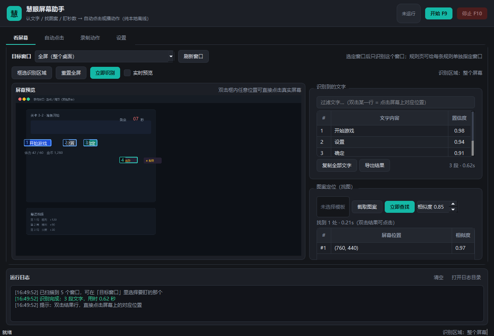
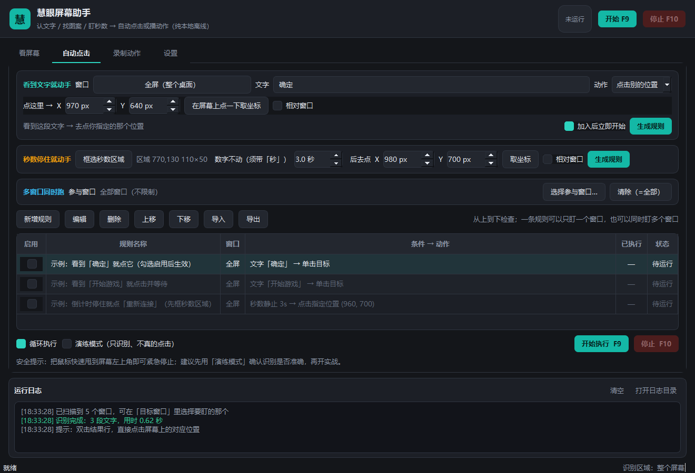
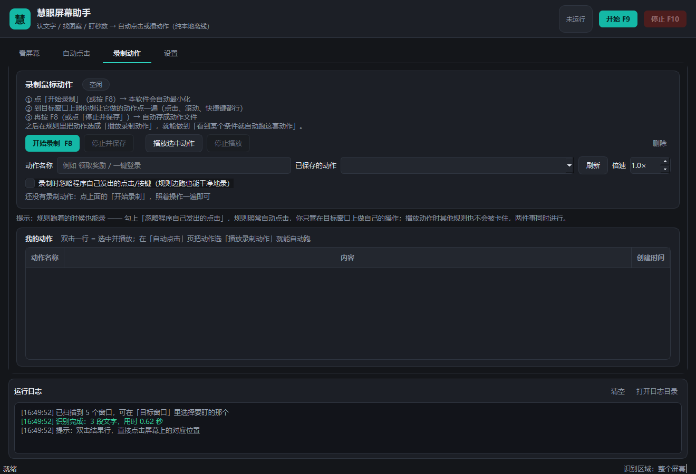
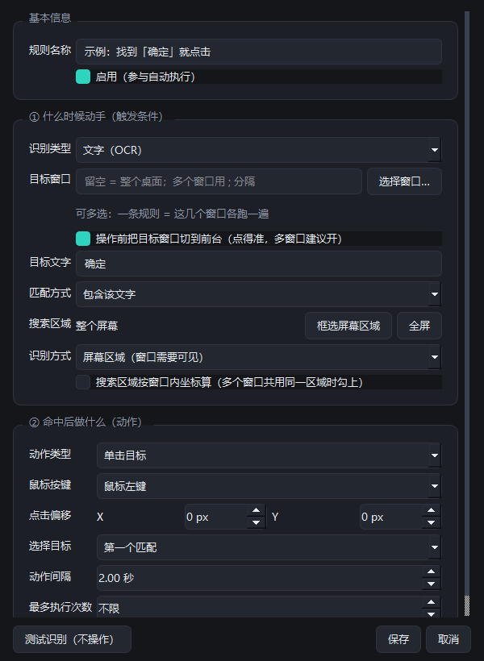
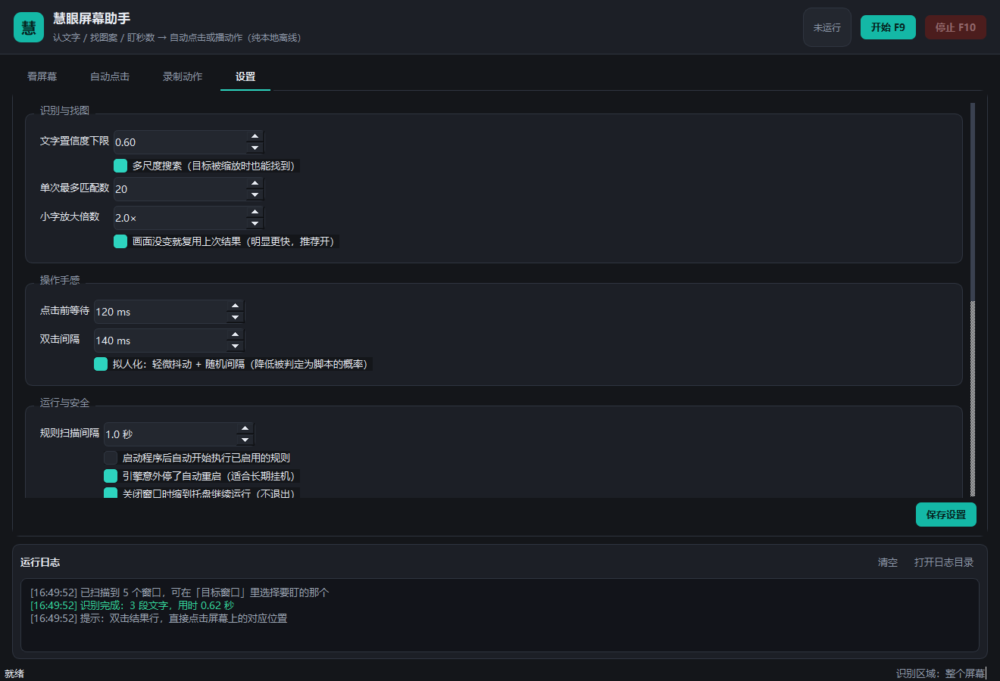

# 慧眼屏幕助手 · ScreenEye（v1.8）

一款 Windows 桌面小工具：**看清屏幕上的文字、图案和倒计时，然后替你动手**。

- 纯本地运行，不联网、不上传屏幕内容、不需要任何 API Key
- 文字识别（OCR）支持中英文混排，图案识别支持图标 / 按钮 / 任意小图
- **可以同时盯多个窗口**：每条规则绑定一个窗口，执行前自动把它切到前台，互不干扰
- **看到文字 / 图案 → 点它，或点"别的位置"，或播放一整套录制好的鼠标动作**
- **秒数停住不动 → 自动点另一个位置**（倒计时卡住、加载不动时最有用）
- **录制动作（F8）**：手点一遍，存成动作，之后"看到某个条件就自动跑这套动作"
- **录制动作和自动点击可以同时跑（v1.2）**：一整套动作在后台回放时，其他规则照样识别、照样点击，互不阻塞
- 关窗口可缩到托盘继续跑、引擎意外停止会自动恢复，适合长期挂着
- 既能当"屏幕放大镜 + 一键点击"的通用助手，也能配规则做网页 / 游戏里的重复操作

---

## 一、三个启动入口

| 方式 | 文件 | 说明 |
| --- | --- | --- |
| 绿色版 EXE（推荐） | `dist\ScreenEye\ScreenEye.exe` | 双击即用，整个 `dist\ScreenEye` 文件夹可拷到别的电脑 |
| 源码版 | `启动屏幕助手.bat` | 双击启动，用项目自带的便携 Python，不污染系统环境 |
| 调试版 | `调试启动.bat` | 带控制台，能看到报错信息 |

> 便携 Python 已装在 `runtime\python\`（Python 3.13），依赖也在里面，不需要另外装 Python。

---

## 二、界面与功能

### 1. 屏幕识别（识别页）



- **目标窗口**（页面顶部下拉框）：选一个窗口后，识别 / 找图只针对这个窗口的**客户区**，窗口被别的窗口挡住、被拖到屏幕外、缩放过都不影响；点「刷新窗口」重新扫一遍当前打开的窗口
- **框选识别区域**：拖框选定一块屏幕，只识别这块；**重置全屏** 恢复整屏（手动框选后下拉框会自动回到"全屏"）
- **立即识别**：抓屏 → OCR → 在预览图上画框并列出文字（含置信度、坐标）
- **双击结果行 / 双击预览里的方框（框内任意位置都行）**：立刻把鼠标移到屏幕上对应的真实位置并点击。v1.5 起：如果那个位置正被本程序自己的窗口盖着，会先把窗口藏起来再点，点完自动回来；目标程序不在前台时也会先切到前台，避免"第一下只用来激活窗口"把点击吃掉。
- **复制全部文字 / 导出结果**（txt 或 CSV，含坐标）
- **实时预览**：不识别、只刷新画面，方便观察目标窗口

### 2. 图案定位（找图）

- **截取图案**：框选屏幕上一小块（图标、按钮、关卡标记…），自动存成模板
- **立即查找**：全屏（或指定区域）多尺度匹配，列出所有出现位置和相似度
- 双击结果 → 点击对应位置；相似度阈值可现场调

### 3. 快捷任务：看到文字就"动手"



规则页最上面那条「看到文字就动手」是最省事的入口，三行就能建一条规则：

1. **窗口**：下拉选一个窗口（默认"全屏 / 整个桌面"）
2. **文字**：填你希望它看到的字，例如 `确定` / `开始游戏` / `领取奖励`
3. **动作**：下拉三选一
   - `点击它` —— 点在文字本身（最常用）
   - `点击别的位置` —— 不管文字在哪，都去点你指定的那个点（先点「在屏幕上点一下取坐标」，勾了「相对窗口」就按窗口内坐标算，窗口挪了也点得准）
   - `播放录制动作` —— 看到这段文字就从头播放一套录好的鼠标动作（先在「录制动作」页录）

点「生成规则」后自动进下表；勾「加入后立即开始」就不必再按 F9。

下面第二条卡「**秒数停住就动手**」是专门的倒计时入口：框一下秒数所在的小区域 → 填"数字不动几秒" → 「取坐标」选停住后要点的地方 → 生成规则，全程点三下鼠标。

### 4. 秒数停住 → 点另一个位置

倒计时、加载进度、排队人数这类"数字"最容易卡住不动，卡住就该点「重新连接」「确定」「再来一局」：

- 程序每轮只在**很小的秒数区域**里做 OCR，识别快、干扰少
- **数字后面必须带「秒」字才认**（v1.8）：`剩余 30 秒`、`30秒`、`1分30秒`、`1:30 秒` 都会触发；只有 `30`、`01:30`、`第3关` 这种没「秒」字的读数**一律不触发**，避免把血量、金币、关卡号当成倒计时
- 连续读到同一个秒数、并且持续时间超过「数字不动 X 秒」→ 触发一次动作
- 数字一变（重新开始倒计时）→ 状态自动重置，不会误触
- 动作推荐选「点击指定位置」（相对窗口客户区更稳），也可以选「播放录制动作」

> 框选秒数区域时，记得把数字**后面的「秒」**也框进去（区域稍微拉宽一点、拉高一点）。如果只框到数字，日志会提示「读到数字但后面没有「秒」字，不按秒数触发」，规则不会动。

日志里会写成「秒数停在 7 超过 3.0 秒，执行动作」，一眼能看出是不是它干的。

### 5. 录制动作（F8）



「录制动作」页把鼠标 / 键盘操作录成一套可回放的动作：

1. 点「开始录制」或按 **F8** → 本软件自动最小化
2. 到目标窗口上把想让它做的动作点一遍（点击、拖动、滚轮、按键都行）
3. 再按 F8（或点「停止并保存」）→ 自动存成动作文件，下方「我的动作」列表能看事件数、时长、点击次数
4. 播放前可调倍速；之后在规则里把动作选成「播放录制动作」即可

录/放规则不用先停：**动作回放和自动点击现在是两条并行的线**（v1.2）。一整套动作在后台按自己的时间轴播放，执行引擎继续扫描屏幕、继续点其他规则的目标，两边互不阻塞。同一时刻只有一只鼠标，所以程序会把"移过去 + 按下 + 抬起"合成一次原子点击，避免两边的点击互相插队（实测：3.9 秒、10 次点击的动作播放期间，另一条规则仍成功点了 5 次，动作本身 10/10 次全部落地）。

如果担心规则自己的点击也被录进去：
- 勾上录制页的「**录制时忽略程序自己发出的点击 / 按键**」，就只会录你本人鼠标键盘的操作，规则跑着也能干净地录；
- 不勾时录到的是全部输入（包括程序发出的），适合录"带规则结果"的完整流程。

### 6. 长期挂机（自动恢复 + 托盘）

- 设置里勾「**引擎意外停了自动重启**」：每 5 秒体检一次，发现规则没在跑（比如线程异常退出）就自动恢复，日志里记一条「看门狗：自动恢复执行」
- 勾「**关闭窗口时缩到托盘继续运行**」：点 ✕ 只是躲进托盘，规则照跑；托盘图标右键可「显示主窗口 / 开始 F9 / 停止 F10 / 退出」
- 再配合「启动程序后自动开始执行已启用的规则」，开机双击 EXE 就能长期维持同一套状态
- 手动按 F10 后看门狗不会抢着重启（尊重你的停止意图）

### 7. 同时控制多个窗口（v1.6 重点）

三种用法，按需选：

| 想要的效果 | 怎么设置 |
| --- | --- |
| 一条规则只伺候某个窗口 | 规则里「目标窗口」只选那一个窗口 |
| 一套规则同时用在几个窗口上 | 规则里「目标窗口」多选几个窗口（一条规则 = 每个窗口各跑一遍） |
| 只让部分窗口被自动操作 | 「自动点击」页的「**多窗口同时跑 → 选择参与窗口…**」勾选清单 |

- 「目标窗口」输入框可以手输标题关键字，多个用 `;` 分隔；也可以点「选择窗口…」在列表里勾选（支持多选、刷新、全选/全不选、已选但当前没打开的窗口也会记住继续等）
- 每个窗口是**独立的通道**：单独截图、单独识别、单独算「动作间隔」，A 窗口卡住冷却时 B 窗口照常干活，互不拖累
- **识别方式**有两种：
  - `屏幕区域`（默认）：抓屏幕对应位置，窗口必须可见；速度快、兼容性最好
  - `窗口后台截图`：直接抓这个窗口自己的画面（PrintWindow），**被别的窗口挡住、不在最前面也能识别**，多个窗口同时跑时推荐这个
- **扫描阶段不抢焦点**：只在真的要点击 / 按键 / 播动作前，才把该窗口切到前台（规则里可关）。所以多个窗口可以一起被盯着，不会来回乱跳
- 标题完全相同的多个窗口（例如两个同款游戏窗口）：勾同一个标题，引擎会把它们都识别出来、各跑一遍
- 找不到窗口 / 窗口最小化了 / 不在「参与窗口」清单里：该窗口这一轮跳过，日志里提示（每 5 秒一次，不会刷屏），恢复后自动继续
- 多个窗口共用同一块「搜索区域」时，勾上「搜索区域按窗口内坐标算」，这样每个窗口都按自己的客户区去裁，不用为每个窗口重框一遍

> 小提示：如果目标程序是游戏 / 浏览器，`窗口后台截图` 有可能抓到黑图（GPU 直绘）。日志会提示「后台截图失败，这次改用屏幕区域」，也可以直接把识别方式改回「屏幕区域」。

### 8. 自动化规则（规则页）

一条规则 = **条件** + **动作** + **节奏**：

| 条件（什么时候动手） | 说明 |
| --- | --- |
| 文字（OCR） | 屏幕上出现某段文字（包含 / 完全等于 / 正则） |
| 图案（找图） | 屏幕上出现某个图标或按钮 |
| 秒数（数字不动） | 指定区域里的数字连续 N 秒读出来都一样（倒计时卡住） |
| 固定坐标 | 不管屏幕内容，直接点某个点（适合固定弹窗按钮） |

| 动作（命中后做什么） | 说明 |
| --- | --- |
| 单击 / 双击 / 右键目标 | 点在命中的位置，可加 X/Y 偏移微调 |
| 点击指定位置 | 忽略命中点，去点你指定的坐标（可按窗口客户区相对计算） |
| 播放录制动作 | 播放一套录好的鼠标 / 键盘动作（可调倍速，后台播放，其他规则同时继续） |
| 点击全部匹配 | 把所有命中的位置依次点一遍（清列表、批量确认很好用） |
| 输入文本 | 点中后输入文字（支持中文） |
| 按下按键 | 点中后按 `enter` / `ctrl+s` / `f5` 等 |
| 滚轮滚动 / 仅移动鼠标 / 仅等待 | 辅助动作 |

节奏参数：`动作间隔`（同一规则两次执行至少隔多久）、`最多执行次数`（0 = 不限）、`选择目标`（第一个 / 最后一个 / 随机）。

规则按列表**从上到下**依次检查，命中即执行，然后各自进入冷却。`F9` 开始、`F10` 停止。



「新增规则 / 编辑」打开的对话框里，除了条件、动作、节奏，还能指定**目标窗口（可多选）**、「操作前把目标窗口切到前台」、「识别方式」（屏幕区域 / 窗口后台截图）。对话框里的「测试识别」会按你选的方式去抓那个窗口试识别，建规则前就能确认对不对。

> v1.7：在图案结果上右键「看到它就…（建规则）」，**不再强制弹出编辑窗口**——点完菜单就直接建好规则并加进列表，三秒一条。想改条件、窗口、间隔、动作，之后在规则表里双击那一行再编辑即可。选「点别处」时会弹一次全屏取点；选「播放录制动作」会问用哪套动作。

> v1.6：对话框里的「目标窗口」改成可多选的输入框 + 「选择窗口…」按钮。勾几个窗口，这一条规则就在每个窗口里各跑一遍；只想盯一个窗口就只勾一个。

### 9. 设置页



文字置信度下限、找图阈值、多尺度搜索、点击前等待、双击间隔、拟人化抖动、扫描间隔、紧急停止、识别前自动最小化本窗口、日志落盘等，改完点「保存设置」即生效。

其中「**启动程序后自动开始执行已启用的规则**」勾上以后，打开程序约 1 秒就自动开始盯屏幕，不用再按 F9（没有启用的规则时会自动跳过）。

### 10. 更快、更准（识别提速）

- **画面没变就复用上次结果**（默认开）：先比对 32×32 灰度缩略图，画面几乎没动就直接沿用上一轮的识别结果，省掉整轮 OCR / 找图
- **反色补识（v1.2）**：深色界面上的白字、亮字（游戏 HUD、黑色弹窗）检测模型容易漏。正常识别没找到目标文字时，会自动把画面反色再识别一遍，坐标完全不变；只在"这一帧没找到"时补一次，命中就写日志「反色补识成功」
- **识别前自动补边（v1.2）**：OCR 前给画面四周补一圈边，贴近窗口边缘、紧贴边框的文字（比如按钮上沿的文字）不再被切掉
- **小字放大倍数**（默认 2.0×）：秒数、小按钮这类窄小区域会先放大再做 OCR，`30 秒`、`1:23 秒` 这种小字的识别率明显提高
- **秒数只框一小块**：区域越小越快越准，建议只框住数字那一小条
- 规则里可以给每条规则单独绑窗口 + 框定搜索区域，避免整屏扫描
- OCR 结果按阅读顺序排好，同一个词出现多处时按「选择目标」取第一个 / 最后一个 / 随机

---

## 三、上手：30 秒做第一条规则

**最快的一条路（看到文字就点）**

1. 打开目标窗口，让它可见。
2. 规则页顶部：选窗口 → 填 `确定` → 动作选「点击它」→ 勾「加入后立即开始」→ 点「生成规则」。
3. 程序开始扫描，日志里出现「命中「确定」→ 单击目标 (x, y)」就说明它在替你点了。

**倒计时卡住就点"重新连接"**

1. 规则页第二条卡：点「框选秒数区域」，把倒计时数字**和它后面的「秒」字**一起框进去（如 `30 秒`）
2. 「数字不动」填 3 秒 → 点「取坐标」，在屏幕上点一下「重新连接」按钮的位置
3. 点「生成规则」→ F9。日志出现「秒数停在 7 超过 3.0 秒，执行动作」就是成功

**看到某个弹窗就播放一整套动作**

1. 「录制动作」页 → F8 开始 → 在目标窗口把整套操作点一遍 → F8 停止自动保存
2. 规则页：文字填弹窗标题字 / 或直接对着识别结果右键「看到它就播放录制动作」
3. 选好动作文件 → 生成规则 → F9

**想更稳一点的做法**

1. **先确认看得见**：识别页选「目标窗口」→ 点「立即识别」→ 确认右侧列表里出现了你要的文字（或者用「截取图案」截一个按钮）。
2. **建规则**：规则页 → 新增规则 → 选条件（文字/图案）→ 绑目标窗口 → 选动作（点它/输入/按键）→ 间隔 2 秒、最多次数先填 5，量小一点。
3. **先演练再实战**：勾上「演练模式（只识别、不真的点击）」→ 按 F9 → 看日志里「演练：命中「xxx」→ 单击目标 (x, y)」是否符合预期 → 取消演练，F9 真跑。

> 演练模式只写日志、不动鼠标，第一次用强烈建议走这一步。

---

## 四、快捷键与安全机制

| 操作 | 说明 |
| --- | --- |
| `F9` | 开始执行规则（任何窗口都有效） |
| `F10` | 立即停止（同时告诉看门狗"是用户要停的"，别自动重启） |
| `F8` | 开始 / 停止录制鼠标动作（录制页与全局都生效） |
| 鼠标甩到屏幕左上角 | 紧急停止（默认开启，可在设置里关） |
| `Esc` | 取消框选 / 取消取点（**v1.3 修好了**：不依赖窗口焦点，全局查键，遮罩没被激活时也能退出） |
| 鼠标右键 | 同 `Esc`：取消框选 / 取消取点 |

另外：

- 「识别前自动最小化本窗口」默认开启，避免把自己的界面拍进去影响识别
- 日志默认写到 `data\logs\日期.log`，出问题可以直接翻记录
- 所有点击都是通过 Win32 `SendInput` 发出的真实输入事件，不是模拟消息

---

## 五、常见问题

**取了坐标 / 框选之后按 Esc 没反应，像卡住了**
v1.3 已修复：遮罩弹出时不一定抢得到键盘焦点（Windows 前台锁、目标程序抢先都可能），以前只有"点过遮罩再按 Esc"才管用。现在改成不依赖焦点、每 30ms 查一次系统级 Esc 键状态，任何焦点下按 Esc 都能立刻关掉；另外**鼠标右键也能取消**，两条退路。

**右键识别结果建规则时，弹窗一闪就没了 / 报错 `no attribute 'ed_template'`**
v1.4 已修复。原因有两个：
1. 图案结果右键里的「建规则」读的是一个根本不存在的控件名（`ed_template`），直接抛 `AttributeError`；现在改用真正的模板路径，顺手把相似度也跟着界面上的「相似度」取值，不再写死 0.82。
2. 以前菜单项的动作是在菜单还开着的时候就去弹模态对话框 / 弹全屏取点，菜单一关会把刚弹出的窗口连带关掉，看起来就是"闪一下就消失"。现在统一改成**菜单完全关闭后再执行**，取点、选动作、提示框都能正常停留。

**双击预览里的框没反应 / 点不到真实屏幕**
v1.5 已修复。原因：预览画面是"识别前自动最小化本窗口"时截的，窗口回来后又正好盖在那个位置上，双击发出的真实点击只落到本程序自己的预览界面上。
现在双击预览框（框内任意位置）或空白处，会先判断那个点是不是被自己的窗口盖着：是就先把窗口藏起来（约 0.2 秒）、点完再自动恢复；目标程序不在前台时也会先把它切到前台，避免第一下点击被"激活窗口"吃掉。

**怎么让几个窗口共用同一套规则？**
规则页「新增规则 / 编辑」→「目标窗口」点「选择窗口…」勾上那几个窗口（也可以直接手输标题，多个用 `;` 分隔）→ 保存。这条规则会为每个窗口单独识别、单独算冷却，一个窗口卡住不会拖累别的窗口。
如果只想让其中一部分窗口被自动操作：在「自动点击」页上方「多窗口同时跑 → 选择参与窗口…」勾选允许的窗口；不在清单里的窗口，规则会自动跳过（日志里会说明是被清单挡掉的）。
窗口被别的窗口挡住、或不想来回切前台时，把规则的「识别方式」改成「窗口后台截图」。

**倒计时明明卡住了，规则却不动（日志说没有「秒」字）**
v1.8 起秒数触发改成"数字后面必须带「秒」"。如果框选区域只框到数字，日志会提示「读到数字但后面没有「秒」字，不按秒数触发」。把框选区域往右、往下拉一点，让数字后面的「秒」也被框进去即可。这样做是为了避免把血量、金币、关卡号这类普通数字当成倒计时误触发。

**多窗口时窗口被抢到前台**
v1.6 起扫描阶段不再抢前台：只有真的要点击 / 按键前，才把目标窗口切到前台（这条可以在规则里关掉）。如果还是嫌切得频繁，把「识别方式」改成「窗口后台截图」——各抓各的画面，连切前台都不需要，只是点击前仍会切一下（真实鼠标点击必须落在最前面的窗口上）。

**窗口标题选错了 / 列表里没有想要的窗口**
下拉框里是"标题 · 进程名"，同名标题的窗口请在规则里手输更完整的标题关键字（区分大小写无关，先精确匹配再子串匹配）。窗口列表不会实时刷新，打开新窗口后点「刷新窗口」。

**识别不准 / 漏字**
降低「文字置信度下限」；把识别区域框小一点（区域越大，模型越吃力）；文字太小可以先放大窗口；漂在动画上的文字识别不稳，可以改用找图。

**找不到图案**
截取模板时尽量只截静态、有辨识度的部分（避开进度条、闪烁图标）；打开「多尺度搜索」；把相似度从 0.85 降到 0.75 试试。

**点击没反应 / 第一次点只是把窗口激活了**
点在其他程序上时，第一次点击通常会被用来把那个窗口切到前台，动作本身被吞掉。规则里把「动作间隔」设大一点、或先手动切到目标窗口再按 F9 能避免。有的游戏用 DirectInput 独占鼠标，普通 SendInput 会被忽略：换成窗口化 / 无边框窗口模式，或以管理员身份运行本程序。

**界面文字模糊**
程序已声明 Per-Monitor V2 DPI 感知，在 125%/150% 缩放下坐标依然按物理像素换算，不会点偏。

**杀软报毒 / 提示风险**
PyInstaller 打包的自动化工具常被启发式误报。源码版（`启动屏幕助手.bat`）可自行查看全部代码；程序不含任何联网、上传、开机自启行为。

**多显示器 / 负坐标**
截图与点击都基于"虚拟桌面"整体坐标，副屏在主屏左侧（负坐标）也能正常识别和点击。

**会不会被游戏判定为脚本**
程序默认开启「拟人化」：移动轨迹插值 + 随机抖动 + 随机延时，但**不能保证**规避任何检测。请自行评估风险。

---

## 六、自检与重新打包

**出问题时先自检**（不开界面，直接验证截屏 / OCR / 找图，结果写进 `data\selftest.json`）：

```
dist\ScreenEye\ScreenEye.exe --selftest
runtime\python\python.exe app\main.py --selftest
```

`selftest.json` 里 `ok: true` 说明识别链路正常。

**单独验证"取坐标时 Esc 能退出"**（会闪一下全屏遮罩，约 1 秒，结果写 `data\esc_selftest.json`）：

```
dist\ScreenEye\ScreenEye.exe --selftest-esc
```

**重新打包 EXE**

双击 `打包EXE.bat`（首次会自动装 PyInstaller，需要几分钟），产物在 `dist\ScreenEye\`。也可以手动执行：

```
runtime\python\python.exe -m PyInstaller --noconfirm --clean --windowed ^
  --name ScreenEye --icon assets\icon.ico --add-data "assets;assets" ^
  --collect-all rapidocr_onnxruntime --hidden-import mss.windows ^
  --workpath build\pyi --specpath build --distpath dist app\main.py
```

---

## 七、目录结构与技术栈

```
ScreenEye/
├─ 启动屏幕助手.bat / 调试启动.bat / 打包EXE.bat
├─ dist/ScreenEye/           打包后的绿色版（可整体拷走）
├─ runtime/python/           便携 Python 3.13 + 全部依赖
├─ app/
│  ├─ main.py                入口（DPI 感知、主题、异常钩子）
│  ├─ config.py              路径与设置持久化
│  ├─ core/
│  │  ├─ capture.py          mss 截屏（多屏虚拟桌面，BGR numpy，区域自动裁剪）
│  │  ├─ windows.py          Win32 窗口枚举 / 标题查找 / 切前台 / 客户区坐标
│  │  ├─ ocr_engine.py       RapidOCR 封装 + 阅读顺序排序 + 文字查找
│  │  ├─ vision.py           OpenCV 模板匹配（多尺度 + Alpha 蒙版 + NMS）
│  │  ├─ actions.py          Win32 SendInput：移动/点击/拖拽/滚轮/中文输入
│  │  ├─ rules.py            规则模型与后台执行引擎（冷却 / 上限 / 秒数静止 / 点别处 / 播动作）
│  │  ├─ timer.py            秒数解析（必须带「秒」：30 秒 / 1:23 秒 / 2分10秒）与"数字不动"状态机
│  │  ├─ recorder.py         全局鼠标键盘钩子录制 + 按时间轴回放
│  │  └─ hotkey.py           RegisterHotKey 全局热键线程
│  └─ ui/
│     ├─ theme.py            深色主题 QSS
│     ├─ preview.py          预览画布（画框、坐标回映射）
│     ├─ region_selector.py  冻结截图上的全屏框选器
│     ├─ point_picker.py     全屏取点器（取"要点的位置"）
│     ├─ rule_dialog.py      规则编辑对话框（按条件/动作自动收起无关项）
│     ├─ recorder_view.py    录制动作页
│     └─ main_window.py      主窗口（托盘 / 看门狗 / 右键建规则）
├─ assets/                   图标
├─ data/                     settings.json / rules.json / templates / logs
└─ docs/screenshots/          界面截图
```

技术栈：PySide6 6.12（Qt 6 界面）、RapidOCR 1.2.3（PP-OCR ONNX 模型，随包离线）、OpenCV 5（模板匹配）、mss（高速截屏）、Win32 `SendInput` / `RegisterHotKey`（输入与热键）。

修改代码后**不用重新打包**，直接双击 `启动屏幕助手.bat` 就能看到效果；`build\` 下是自测脚本（`test_core.py` 核心能力、`test_e2e.py` 真实识别点击链路、`test_multiwin.py` 两个互相覆盖的窗口各自被点中、`test_v3.py` 秒数静止→点别处 + 录制回放、`test_v4.py` 识别到文字/图案→自动播放录制动作、`render_ui.py` 界面出图）。

---

## 八、使用边界

本工具是通用屏幕自动化助手。自动化操作可能违反部分网络服务或游戏的服务条款，请只在你有权操作的软件、自己的账号和本地环境中使用，不要用于刷量、外挂、抢购脚本等违规用途。程序不会收集或上传任何数据。

---

## 九、开源许可证

本项目采用 **MIT License**，可自由使用、修改、商用和再分发，只需保留版权声明与许可证文本。第三方依赖的许可证见 [THIRD_PARTY_NOTICES.md](THIRD_PARTY_NOTICES.md)。

源码仓库不包含便携 Python 运行时和大体积二进制；需要解压即用的版本请到群文件或 Releases 附件下载。
